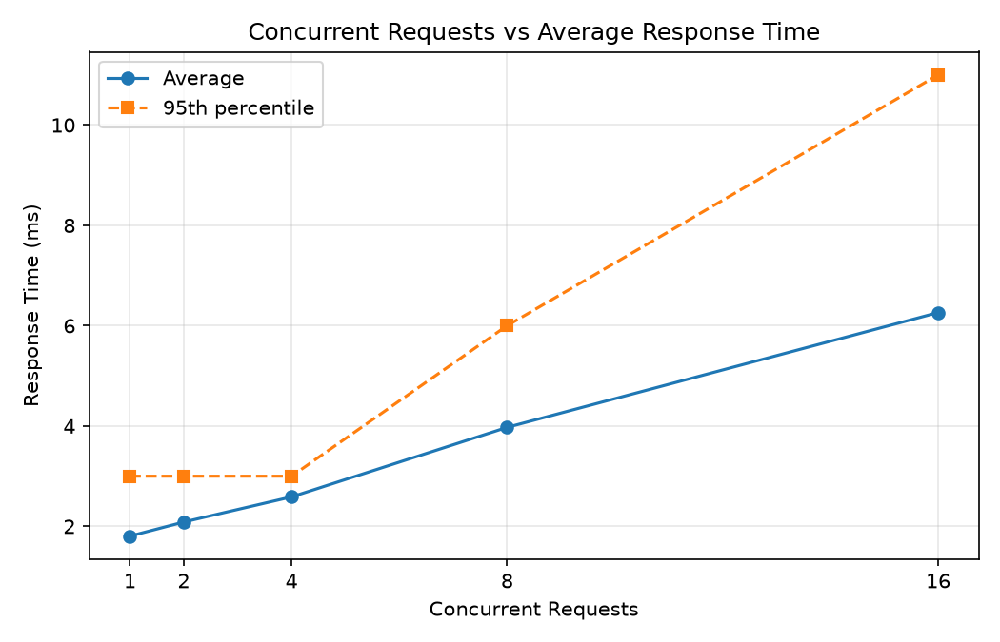
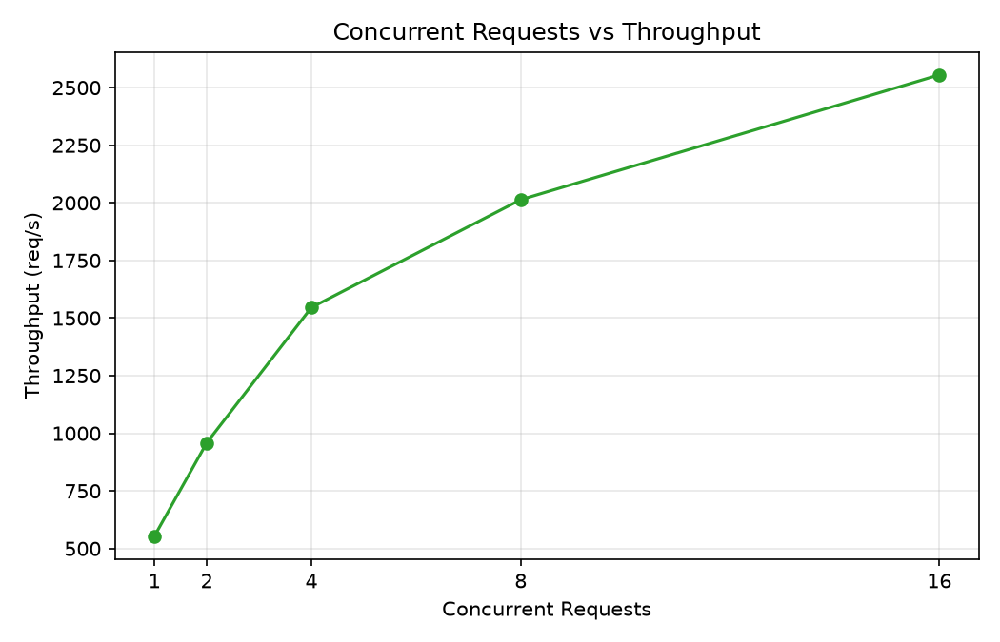
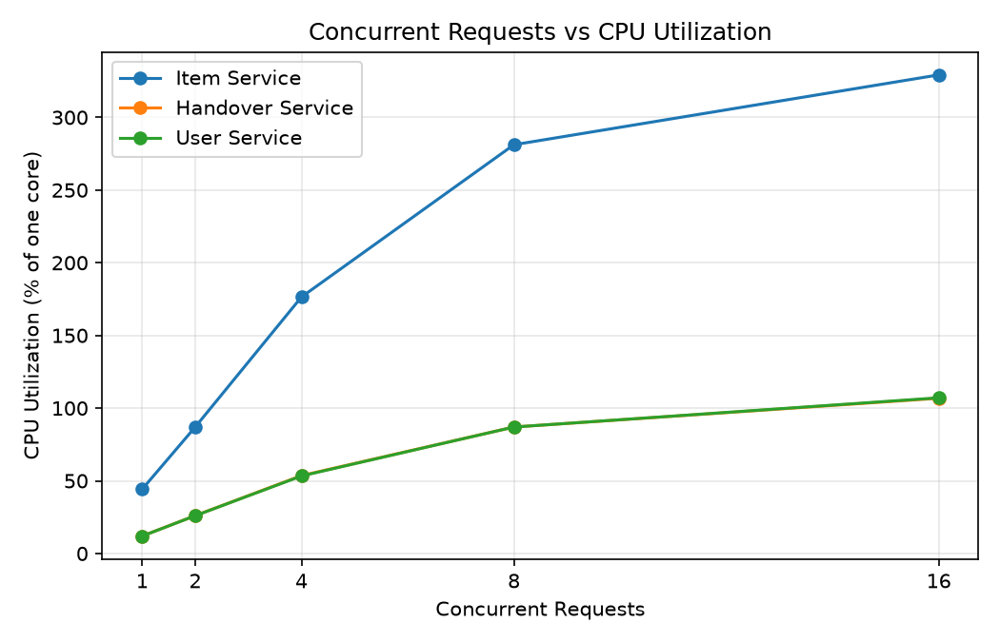
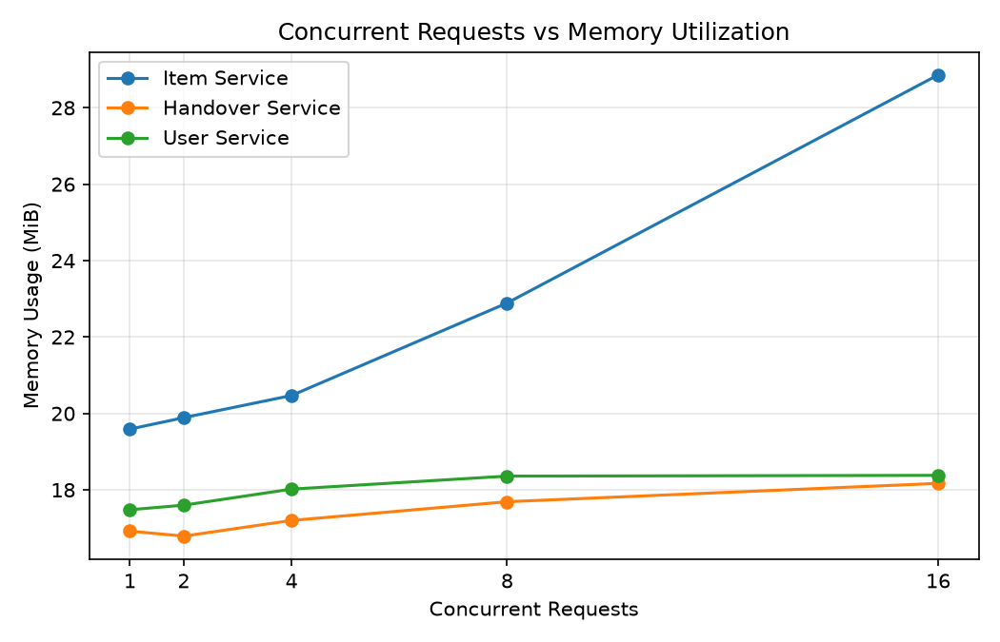

# Lost and Found Microservices Performance Analysis

A containerized Lost and Found application developed as a three-microservice system and evaluated under varying workloads.

This repository contains the **original PHP microservice implementation used for the performance experiment** and the **new Dockerized FastAPI implementation with Swagger/OpenAPI documentation, MySQL integration, and inter-service communication**.

## Project Overview

The application is divided into three independent services:

| Microservice | Responsibility | Original PHP Port | FastAPI Port |
|---|---|---:|---:|
| User Service | User-related operations | 8081 | 8001 |
| Item Service | Lost and found item operations | 8082 | 8002 |
| Handover Service | Item handover and return operations | 8083 | 8003 |

### Original PHP Implementation

The original implementation uses PHP 8.2 and Apache. These services were containerized with Docker Compose and used for the workload/performance experiment.

### New FastAPI Implementation

The new implementation is located in `fastapi-services/` and provides REST APIs, automatic Swagger documentation, MySQL connectivity, Dockerized deployment, and inter-service communication.

The PHP implementation is the one used for the measured performance results.

## Architecture


### FastAPI Service Flow

```text
                    PHP Web Frontend / Client
                              |
                              | HTTP
                              v
                   +------------------------+
                   |      Item Service      |
                   |        FastAPI        |
                   |       Port 8002       |
                   +-----------+------------+
                               |
                    +----------+----------+
                    |                     |
                  HTTP                  HTTP
                    |                     |
                    v                     v
          +----------------+     +--------------------+
          |  User Service  |     | Handover Service   |
          |    FastAPI     |     |      FastAPI       |
          |    Port 8001   |     |      Port 8003     |
          +-------+--------+     +---------+----------+
                  |                        |
                  +-----------+------------+
                              |
                              v
                       MySQL Database
                     college_lost_found
```

Inside Docker, services communicate using service names:

```text
http://user-service:8000
http://item-service:8000
http://handover-service:8000
```

From the host machine:

```text
http://localhost:8001
http://localhost:8002
http://localhost:8003
```

## Technologies

| Technology | Purpose |
|---|---|
| PHP 8.2 | Original microservice implementation |
| Apache | Web server for original PHP services |
| Python | FastAPI implementation |
| FastAPI | REST API framework |
| Uvicorn | FastAPI application server |
| MySQL | Database |
| mysql-connector-python | MySQL connectivity |
| Requests | HTTP communication between services |
| Docker | Containerization |
| MySQL (container) | Database for the FastAPI services |
| Docker Compose | Multi-container deployment |
| Docker Bridge Network | Inter-service communication |
| Swagger / OpenAPI | Interactive API documentation |
| ApacheBench | Workload generation |
| Pandas | Result data handling |
| Matplotlib | Graph generation |
| Git | Version control |
| GitHub | Repository hosting |

## Project Structure

```text
lostfound-microservices/
│
├── docker-compose.yml
├── README.md
│
├── user-service/                    # Original PHP service
│   ├── Dockerfile
│   └── index.php
├── item-service/                    # Original PHP service
│   ├── Dockerfile
│   └── index.php
├── handover-service/                # Original PHP service
│   ├── Dockerfile
│   └── index.php
│
├── results/
│   ├── workload_results.csv
│   ├── response_time.png
│   ├── throughput.png
│   ├── cpu_utilization.png
│   └── memory_utilization.png
│
└── fastapi-services/                # New FastAPI implementation
    ├── docker-compose.yml
    ├── user-service/
    │   ├── Dockerfile
    │   ├── main.py
    │   └── requirements.txt
    ├── item-service/
    │   ├── Dockerfile
    │   ├── main.py
    │   └── requirements.txt
    └── handover-service/
        ├── Dockerfile
        ├── main.py
        └── requirements.txt
```

# Original PHP Microservice Implementation

The original three services remain in the repository.

### User Service

```text
GET http://localhost:8081/
```

### Item Service

```text
GET http://localhost:8082/
```

### Handover Service

```text
GET http://localhost:8083/
```

Each original service uses PHP 8.2 with Apache and has its own Dockerfile.

```dockerfile
FROM php:8.2-apache

COPY index.php /var/www/html/index.php

EXPOSE 80
```

Original container mapping:

| Service | Container Name | Host Port | Container Port |
|---|---|---:|---:|
| User Service | lostfound-user | 8081 | 80 |
| Item Service | lostfound-item | 8082 | 80 |
| Handover Service | lostfound-handover | 8083 | 80 |

## FastAPI Microservices

The new FastAPI implementation is located in:

```text
fastapi-services/
```

There are exactly three independent FastAPI services.

### User Service

Manages user information stored in the MySQL `users` table.

| Method | Endpoint | Purpose |
|---|---|---|
| GET | `/users` | List users |
| GET | `/users/{user_id}` | Get one user's details |
| POST | `/users` | Create a new user (409 if USN/email already exists) |

Swagger:

```text
http://localhost:8001/docs
```

### Item Service

Manages lost and found item information stored in the MySQL `items` table.

| Method | Endpoint | Purpose |
|---|---|---|
| GET | `/items` | List items |
| GET | `/items/{item_id}` | Get one item |
| POST | `/items` | Create a new item |
| GET | `/item-summary/{item_id}` | End-to-end: item + calls User and Handover services (502 if one is down) |

Swagger:

```text
http://localhost:8002/docs
```

### Handover Service

Provides handover-related information.

| Method | Endpoint | Purpose |
|---|---|---|
| GET | `/handovers` | List handover details |
| GET | `/handovers/{item_id}` | Get handover details for an item |

Swagger:

```text
http://localhost:8003/docs
```

## FastAPI Database Configuration

The FastAPI compose file now starts its own MySQL container (`fastapi-db`, image `mysql:8.0`) and
creates the `college_lost_found` schema + sample data from `fastapi-services/db/init.sql`
on first start. The database is only reachable inside the Docker network (not published to the host).

Connection settings are read from environment variables (`DB_HOST`, `DB_PORT`, `DB_USER`,
`DB_PASSWORD`, `DB_NAME`) set in `docker-compose.yml`. The root password defaults to
`lostfound_root`; override it with `DB_PASSWORD=yourpass docker compose up -d`.

> The `db` container is supporting infrastructure, not a fourth microservice.
> The schema in `init.sql` was reconstructed from the SQL queries in the services; if your real XAMPP
> schema differs, adjust `init.sql`.

To use XAMPP MySQL on the host instead, remove the `db` service / `depends_on`, and set
`DB_HOST=host.docker.internal` (on Linux also add `extra_hosts: ["host.docker.internal:host-gateway"]`).

## Swagger / OpenAPI Documentation

FastAPI automatically generates interactive API documentation.

| Service | Swagger URL |
|---|---|
| User Service | http://localhost:8001/docs |
| Item Service | http://localhost:8002/docs |
| Handover Service | http://localhost:8003/docs |

A combined Swagger UI for all three services (dropdown at top right) is available at **http://localhost:8080** (`swagger-ui` container in the FastAPI compose file).

Swagger allows the evaluator to view endpoints, request bodies, parameters, and responses directly from the browser.

## FastAPI Docker Configuration

Each FastAPI service has its own Dockerfile and `requirements.txt`.

Typical Dockerfile:

```dockerfile
FROM python:3.13-slim

WORKDIR /app

COPY requirements.txt .
RUN pip install --no-cache-dir -r requirements.txt

COPY main.py .

EXPOSE 8000

CMD ["uvicorn", "main:app", "--host", "0.0.0.0", "--port", "8000"]
```

## FastAPI Docker Compose

Navigate to:

```powershell
cd C:\xampp2\htdocs\lostfound-microservices\fastapi-services
```

Build:

```powershell
docker compose build
```

Start:

```powershell
docker compose up -d
```

Check containers:

```powershell
docker ps
```

Expected FastAPI containers:

```text
fastapi-user
fastapi-item
fastapi-handover
```

Port mapping:

| Service | Host Port | Container Port |
|---|---:|---:|
| User Service | 8001 | 8000 |
| Item Service | 8002 | 8000 |
| Handover Service | 8003 | 8000 |

Stop:

```powershell
docker compose down
```

## Inter-Service Communication

The FastAPI Item Service communicates with the other services using Docker service names.

```text
Item Service
     |
     +---- HTTP ----> User Service
     |
     +---- HTTP ----> Handover Service
```

Examples:

```text
http://user-service:8000
http://handover-service:8000
```

This demonstrates service discovery and communication over the Docker network.

## Workload Testing Method

ApacheBench (`ab`) generated load against the **original PHP Item Service**, whose single `GET /`
request triggers an end-to-end chain: Client → Item Service → User Service + Handover Service.

Test endpoint: `http://localhost:8082/`

* 5 workload levels: 1, 2, 4, 8, 16 concurrent requests
* Each run lasts **15 seconds** (time-based, `ab -t 15`) and is **repeated 3 times**; the table shows averages
* `docker stats` is streamed **during** the load and averaged over the run (earlier versions took a snapshot after the test, which showed idle CPU)
* Failed requests = ab "Failed requests" + "Non-2xx responses"
* A 5-second warm-up precedes the measurements

Everything is automated:

```bash
docker compose up -d --build
python3 scripts/run_benchmark.py --url http://localhost:8082/ \
    --containers lostfound-item:Item lostfound-handover:Handover lostfound-user:User --outdir results
python3 scripts/make_graphs.py results
```

(on Windows use `--ab "C:\xampp2\apache\bin\ab.exe"`; needs `pip install pandas matplotlib`)

Raw `ab` output and every `docker stats` sample are saved in `results/raw/`.

> **About the numbers below:** they were produced in a **1-CPU-core, 4 GB Linux sandbox** with the load generator
> on the same machine as the containers, using locally built stand-ins for the base images
> (Ubuntu Apache 2.4.58 + mod_php 8.3 instead of `php:8.2-apache`). Absolute values will differ on your computer,
> so **re-run the commands above on your own machine** before presenting and use your own figures.

## Measured Performance Results

| Concurrent Requests | Avg Response Time (ms) | p95 (ms) | Throughput (req/s) | Failed Requests |
|---|---:|---:|---:|---:|
| 1 | 2.589 | 3.7 | 388.12 | 0 |
| 2 | 5.201 | 8.0 | 384.69 | 0 |
| 4 | 10.621 | 17.7 | 377.19 | 0 |
| 8 | 21.172 | 31.0 | 378.24 | 0 |
| 16 | 45.256 | 64.7 | 353.55 | 0 |

## Container Resource Measurements (averaged during load)

| Concurrent Requests | Item CPU (%) | Item Mem (MiB) | Handover CPU (%) | Handover Mem (MiB) | User CPU (%) | User Mem (MiB) |
|---|---:|---:|---:|---:|---:|---:|
| 1 | 30.06 | 17.77 | 12.27 | 14.62 | 11.89 | 15.33 |
| 2 | 30.28 | 17.79 | 12.05 | 14.64 | 11.92 | 15.34 |
| 4 | 30.33 | 18.01 | 11.79 | 15.15 | 11.61 | 15.36 |
| 8 | 32.35 | 22.08 | 11.92 | 16.23 | 11.75 | 16.00 |
| 16 | 32.85 | 29.35 | 11.74 | 17.12 | 11.59 | 17.12 |

CPU % is relative to one core (as reported by `docker stats`).

## Performance Visualizations






## Result Analysis

**Response time** grew almost linearly with concurrency: 2.6 ms at 1 request to 45.3 ms at 16 (p95 64.7 ms).
**Throughput did not scale**: it stayed at roughly 350–390 req/s from 1 to 16 clients and dipped slightly at 16.
The service was already saturated at one client, so extra concurrent requests only queued
(by Little's Law, 16 clients ÷ ~354 req/s ≈ 45 ms, matching the measured value). This is the classic
saturation pattern: latency rises, throughput stays flat.

**Failed requests:** none at any level (every run completed 15,900–17,500 requests with 0 failures).
Stopping a dependency does cause failures by design — the Item Service now returns HTTP 502 instead of a misleading 200.

**CPU:** the **Item Service** used the most CPU (~30–33% of a core), about 2.5× the User or Handover service (~12%),
because every client request makes it perform its own work plus two outgoing HTTP calls. CPU stayed almost constant
across levels because the machine was already saturated; the rest of the single core was used by the load generator
and the Docker/Apache overhead.

**Memory:** the Item Service also used the most memory at high load, growing from 17.8 to 29.4 MiB as Apache (prefork)
started more worker processes to serve concurrent requests; User/Handover grew only slightly (~15 → 17 MiB).
Memory was never a bottleneck.

**Limitations:** single-core test machine, load generator on the same host, only 3 repetitions per level.

## Result Files

```text
results/workload_results.csv      (averages + p50/p95/max, peak CPU, memory %)
results/response_time.png
results/throughput.png
results/cpu_utilization.png
results/memory_utilization.png
results/raw/                      (raw ab output + docker stats samples)
scripts/run_benchmark.py          (workload generator + monitor)
scripts/make_graphs.py            (graph generator)
```

## Verification Commands

Original PHP services:

```powershell
docker compose up -d
docker ps
docker network ls
```

FastAPI services:

```powershell
cd C:\xampp2\htdocs\lostfound-microservices\fastapi-services
docker compose up -d
docker ps
```

Stop FastAPI:

```powershell
docker compose down
```

## Experiment Outcome

The project demonstrates a complete three-microservice architecture with REST APIs, Docker containerization, Docker Compose deployment, Docker network communication, MySQL integration, Swagger documentation, inter-service HTTP communication, workload generation, resource monitoring, and performance analysis.

The original PHP implementation was used for the measured workload experiment, while the new FastAPI implementation provides a modern REST-based microservice layer with interactive Swagger documentation.

## Repository

GitHub:

https://github.com/sunayanakamat04/lostfound-microservices
